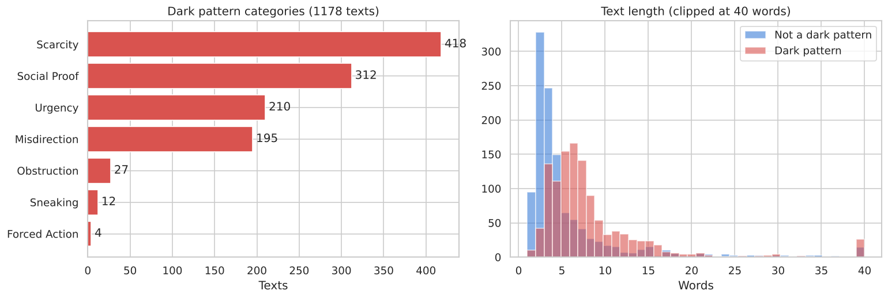
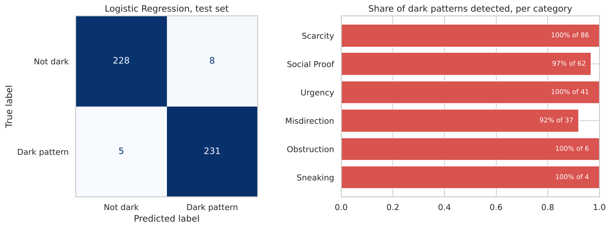
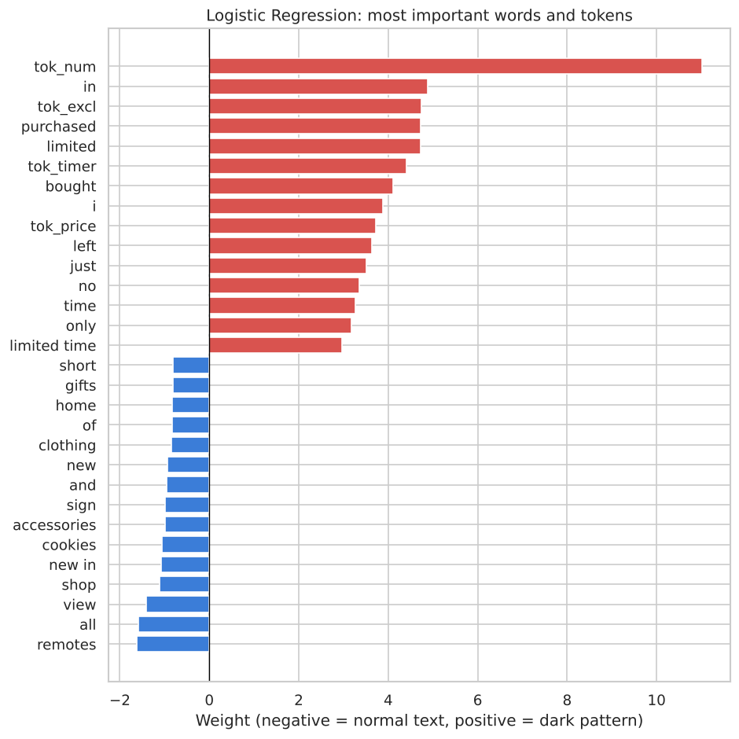

# Detecting Dark Patterns in E-commerce Text

**Dark patterns** are interface designs that push people into decisions they did not intend: fake countdown timers, "Only 2 left!" pressure, invented popularity ("23 people are viewing this"), or guilt-tripping opt-outs ("No thanks, I don't want to save money").

This project trains classifiers that detect dark patterns in short website texts, analyses what they learn and where they fail, and provides a small web app to try them.

**Skills shown:** NLP preprocessing · TF-IDF · Logistic Regression, SVM, Random Forest, Naive Bayes · hyperparameter tuning · grouped cross-validation · error analysis · model interpretation · BERT fine-tuning (PyTorch) · Gradio app · OCR

---

## Data

2,356 texts from e-commerce websites, from the dataset of [Yada et al. (2022)](https://arxiv.org/abs/2211.06543) ([GitHub](https://github.com/yamanalab/ec-darkpattern), Apache 2.0). The dark pattern texts were originally collected by Mathur et al. (2019) from a crawl of 11,000 shopping websites; the normal texts were scraped from the same websites.

* 1,178 dark patterns and 1,178 normal texts, from 1,248 websites
* Very short texts: median 3 words for normal texts, 6 for dark patterns



## Method

1. **Text cleaning that keeps the signals.** Numbers, prices, timers, percentages and exclamation marks are replaced by tokens (`tok_num`, `tok_price`, `tok_timer`, `tok_percent`, `tok_excl`) instead of being deleted. Stopwords are kept.
2. **Split by website.** 20% of the websites (472 texts) form the test set. No website appears in both training and test data, so the test measures performance on **shops the model has never seen**.
3. **Four classical models** (TF-IDF + Logistic Regression, SVM, Random Forest, Multinomial Naive Bayes), tuned with `GridSearchCV` using 5-fold cross-validation grouped by website.
4. **Model choice by cross-validation**, preferring the simplest model when scores are within one standard deviation; then **one evaluation** on the test set.
5. **Optional BERT** fine-tuning on the same split.

## Results

### Cleaning mattered more than the model

The first version of this project removed everything except letters, plus English stopwords. That deletes exactly what many dark patterns are made of:

| Original | First version | New cleaning |
|---|---|---|
| Hurry! Only 2 left in stock | hurry left stock | hurry tok_excl only tok_num left in stock |
| 0:44:56 | *(empty)* | tok_timer |
| $132.90 $99.00 | *(empty)* | tok_price tok_price |
| 23 people are viewing this right now | people viewing right | tok_num people are viewing this right now |

Same Logistic Regression, 5-fold CV grouped by website on the training set:

| Preprocessing | Accuracy | F1 | ROC AUC |
|---|---|---|---|
| First version: letters only, stopwords removed | 94.5% | 94.4% | 0.979 |
| **New cleaning, stopwords kept** | **96.1%** | **96.1%** | **0.989** |

### Model comparison

| Model | CV F1 | Test accuracy | Test precision | Test recall | Test F1 | Test ROC AUC |
|---|---|---|---|---|---|---|
| **Logistic Regression (final)** | 96.5% | **97.3%** | 96.7% | 97.9% | **97.3%** | 0.995 |
| SVM (RBF kernel) | 96.6% | 97.0% | 96.6% | 97.5% | 97.1% | 0.995 |
| Random Forest | 96.0% | 96.8% | 97.0% | 96.6% | 96.8% | 0.997 |
| Multinomial Naive Bayes | 88.7% | 92.2% | 87.6% | 98.3% | 92.6% | 0.989 |

Logistic Regression, SVM and Random Forest are within about one point of each other. Logistic Regression was chosen because it is as good as the SVM within the cross-validation noise, much faster, and its decisions can be read directly from the word weights. Its test results are on the level of the [published baseline](https://github.com/yamanalab/ec-darkpattern#baseline-evaluation) for this dataset (Logistic Regression 96.1% accuracy, BERT 97.2%), although on a different split.



Only **13 of 472** test texts are misclassified. Scarcity and Urgency patterns are all detected; Misdirection is the hardest category (92%), because it often depends on wording and design rather than obvious keywords.

### What the model learned, and where it fails



* The strongest signals for dark patterns are **numbers** (`tok_num`), **exclamation marks**, **timers**, **prices** and words like *limited*, *purchased*, *bought*, *left*, *only* and *just*. These are exactly the building blocks of scarcity, urgency and social proof messages.
* The model **leans heavily on numbers**. Harmless text such as "Free returns within 30 days" is flagged with 76% probability.
* Several false alarms are **enthusiastic customer reviews** ("I absolutely loved it! …"), which share exclamation marks and positive wording with social proof patterns.
* Missed dark patterns are mostly **subtle Misdirection** texts such as "Yes! Upgrade my purchase" or "Let's make sure you have everything else you need".

So the model recognises the *typical wording* of dark patterns very well, but not the manipulation itself.

## Web app: Dark Pattern Detector

`app.py` is a small [Gradio](https://www.gradio.app/) app where anyone can test the model:

* **Text tab:** paste the text of a button, banner or product notice. The app shows the probability of a dark pattern and the words that influenced the decision most.
* **Screenshot tab:** upload a screenshot of a web page. The app reads the text with Tesseract OCR and checks every line.

Start it from a terminal with `python app.py`, or run the last section of the notebook.

```bash
pip install -r requirements.txt
jupyter notebook dark_pattern_detection.ipynb   # run once: trains and saves the model to models/
python app.py                                   # opens the app in the browser
```

For the screenshot tab, install [Tesseract OCR](https://github.com/tesseract-ocr/tesseract). On Windows, set the environment variable `TESSERACT_CMD` to the path of `tesseract.exe` if it is not on your PATH.

## Run it yourself

```bash
git clone https://github.com/elmoussaouioumayma/dark-pattern-detection.git
cd dark-pattern-detection
pip install -r requirements.txt
jupyter notebook dark_pattern_detection.ipynb
```

The classical models run in about a minute. To also fine-tune BERT (15–30 minutes on a CPU), set `RUN_BERT = True` in the first code cell.

## Project structure

```
dark-pattern-detection/
├── dark_pattern_detection.ipynb   # full analysis: data, cleaning, models, evaluation, BERT
├── text_utils.py                  # text cleaning shared by the notebook and the app
├── app.py                         # Gradio web app (text and screenshot)
├── data/dataset.tsv               # dataset by Yada et al. (2022), see data/README.md
├── images/                        # figures used in this README
├── requirements.txt
└── LICENSE
```

## Limitations

* **Text only.** Many dark patterns are visual (button colours, pre-ticked boxes, hidden links) and cannot be detected from text.
* **Rare categories.** Sneaking (12 texts) and Forced Action (4) are too rare to learn reliably.
* **Surface signals.** The model relies strongly on numbers and typical phrases, which causes false alarms on harmless text with numbers.
* **One domain and time.** English-language shopping websites, collected in 2019.

## Context

Developed as a course project in the M.Sc. Machine Learning and Data Analytics programme at Hochschule Aalen, and revised for this portfolio.

## License

Code: [MIT](LICENSE). Dataset: Apache 2.0, by Yada et al., see [data/README.md](data/README.md).
